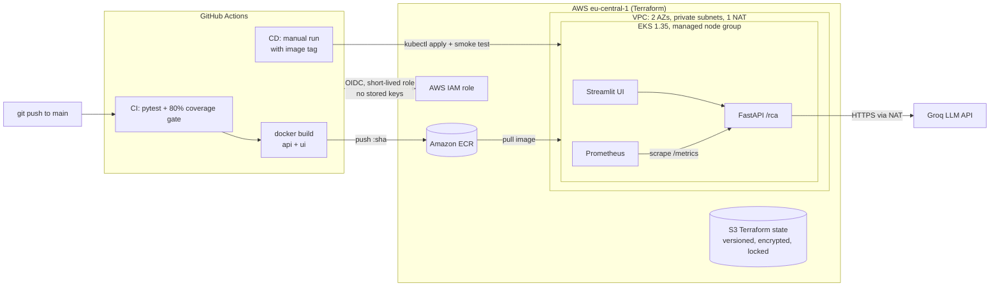
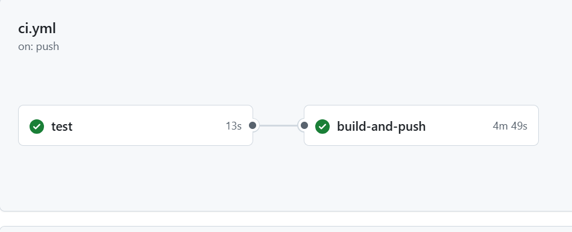

# Auto-RCA Bot on AWS EKS

[](https://github.com/HosurSharanamma/devops-auto-rca-bot/actions/workflows/ci.yml)

An AI assistant for Jenkins build failures, deployed to **AWS EKS** with
**Terraform**, shipped by **GitHub Actions**, and monitored with **Prometheus**.

You paste a failed Jenkins log. The service cleans it, hides secrets and
personal data, finds similar past failures (RAG over ChromaDB), and asks an
LLM for a root cause and a fix grounded in those past cases.

**What this repo shows**

- **Infrastructure as code** — VPC, EKS 1.35, ECR, IAM and the state bucket are all Terraform. Two stacks: a long-lived base and a cluster that is created and destroyed each session.
- **No stored AWS keys** — GitHub Actions gets AWS access through OIDC, limited to this one repo.
- **Test gate before build** — 78 tests and an 80% coverage minimum must pass before any image is built or pushed.
- **Traceable images** — every image is tagged with its commit SHA; only `main` can move `:latest`.
- **Checked deployments** — CD applies all manifests, waits for rollout, then checks `/readyz`, `/health` and `/metrics`.
- **Monitoring** — the API exposes Prometheus metrics; Prometheus runs in the cluster and finds pods by annotation.
- **Cost control** — about $0.20/hour while the cluster is up; it is destroyed after every session.

## Architecture



Inside the API, each request goes through: input checks → PII and secret
masking → retrieval of similar incidents → LLM call (with retries, JSON
validation and a fallback) → structured answer.

## CI/CD pipeline

```
push to main
   │
   ▼
CI ── test job ────────────────────────────────┐
   │   pytest (78 tests, no model/DB/LLM)      │ fails → stop.
   │   coverage must be ≥ 80%                  │ Nothing is built.
   │   JUnit + coverage XML uploaded           │
   ▼                                           ┘
CI ── build-and-push job
   │   OIDC → AWS role (no access keys)
   │   build api + ui images
   │   push :<commit-sha>  (+ :latest on main only)
   ▼
CD ── manual, choose the image tag
       registry + tag filled into k8s/*.yaml
       kubectl apply → wait for rollout
       smoke test: /readyz, /health, /metrics
```

CD is manual on purpose: the cluster only exists while I am working on it,
so an automatic deploy would fail most of the time.

**The test gate in action** (CI run on `main`):



## Repo layout

| Folder | What it holds |
|---|---|
| `terraform-base/` | Long-lived stack: S3 state bucket, ECR repos, GitHub OIDC provider and role |
| `terraform/` | Per-session stack: VPC, EKS cluster, node group, access for the CD role — [README](terraform/README.md) |
| `k8s/` | Namespace, ConfigMap, API and UI Deployments/Services, Prometheus — [README](k8s/README.md) |
| `.github/workflows/` | `ci.yml` (test → build → push), `cd.yml` (deploy → smoke test) |
| `docker/` | Dockerfiles for the API and UI |
| `api/` | FastAPI app: `/rca`, `/health`, `/readyz`, `/metrics`, startup warm-up |
| `rag/` | Embeddings, ChromaDB store, retrieval, LLM call and answer checks |
| `utils/` | Log cleaning, PII and secret masking |
| `tests/` | 78 offline tests with markers (`unit`, `pii`, `api`, …) |
| `docs/capstone/` | The original offline course version of this project, kept for history |

## Run it

### On AWS

```bash
# 1. Long-lived base (once). The state bucket name ends in your account ID,
#    so it is passed at init time instead of being committed.
cd terraform-base
terraform init -backend-config="bucket=auto-rca-bot-tfstate-$(aws sts get-caller-identity --query Account --output text)"
terraform apply

# 2. Cluster (each session)
cd ../terraform
terraform init -backend-config="bucket=auto-rca-bot-tfstate-$(aws sts get-caller-identity --query Account --output text)"
terraform apply                      # ~12–15 min

# 3. Deploy: GitHub → Actions → "CD - deploy to EKS" → Run workflow
#    Needs repo variable AWS_ROLE_ARN and secret LLM_API_KEY.

# 4. Open the UI
kubectl port-forward -n auto-rca-bot svc/auto-rca-bot-ui 8501:8501

# 5. Always, at the end of the session
terraform destroy
```

The first-time setup for the bucket (local state first, then migrate) is
explained in `terraform-base/state-bucket.tf`.

### Locally with Docker

```bash
export LLM_API_KEY=<your Groq key>
docker compose up --build
# UI: http://localhost:8501   API: http://localhost:8000/health
```

### Tests only (no model, database or LLM needed)

```bash
pip install pytest pytest-cov fastapi httpx prometheus-client requests "tenacity>=8.1.0,<9"
python -m pytest                       # all 78 tests, about 1 second
python -m pytest -m pii -v             # only secret / PII masking tests
python -m pytest --cov=api --cov=rag --cov=utils --cov-report=term-missing
```

## Design choices and known limits

- **NodePort + port-forward, no load balancer.** Saves cost; the app is not public. A real setup would use an Ingress with TLS.
- **One NAT gateway, not one per AZ.** Cheaper, but one AZ failure cuts internet access for the nodes.
- **Public EKS API endpoint.** Fine for a personal project; production would limit it to a VPN or fixed IP range.
- **LLM is an external API (Groq).** Logs are masked before they leave the cluster, but a strict on-prem setup would host the model itself. The code still works with a local OpenAI-compatible server (e.g. LM Studio) by changing `LM_STUDIO_BASE_URL`.
- **Small dataset.** 40 synthetic Jenkins incidents in 10 categories — enough to prove the pipeline, not to claim real-world accuracy.

## How the AI part works

<details>
<summary>RAG pipeline, data and evaluation</summary>

```
Jenkins failure log
  → utils/log_cleaning.py   strip ANSI/timestamps, reject empty or binary input
  → utils/pii_masking.py    mask emails, IPs, tokens, keys, secrets
  → rag/retrieval.py        top-k similar incidents from ChromaDB (MiniLM embeddings)
  → rag/rca_generation.py   grounded prompt → LLM (OpenAI-compatible API)
                            retries with backoff, JSON validation,
                            low-confidence flag, fallback to LLM-only reasoning
  → RCA + fix recommendation
```

Rebuild the data and index locally:

```bash
python scripts/generate_synthetic_data.py   # 40 labelled logs, 10 root-cause categories
python finetune/finetune_embeddings.py      # optional: domain fine-tuning of MiniLM
python scripts/ingest_logs.py               # load into ChromaDB
python scripts/evaluate_retrieval.py        # Top-1 / Top-3 accuracy → data/evaluation_report.json
```

`jenkins/Jenkinsfile.example` shows how a real pipeline would call `/rca`
on failure and post the result to Slack.

</details>
